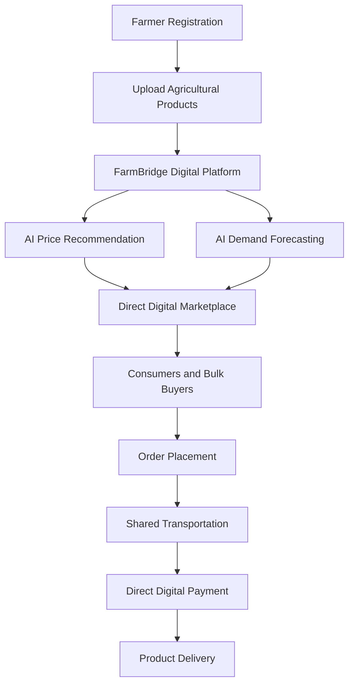

# Smart India Hackathon Workshop

# Date: 27-11-2026

## Reference Number:
(Enter your reference number)

## Name:
Sivadarshini

## Problem Title
SIH 26033: Multiple intermediaries reduce farmers' earnings and increase consumer prices.

## Problem Creater's Organization
Ministry of Consumer Affairs, Food & Public Distribution

## Theme
Agriculture, FoodTech & Rural Development

## Problem Description

Expected Solution: Create a digital marketplace that:

- Connects farmers/FPOs directly with consumers and bulk buyers.
- Provides logistics support.
- Uses AI for demand forecasting and route optimization.

Benefits:

- Better prices for farmers.
- Lower prices for consumers.
- Reduced supply chain inefficiencies.

## Proposed Solution

### FarmBridge – AI-Powered Direct Farmer-to-Consumer Marketplace

FarmBridge is an innovative digital platform designed to connect farmers directly with consumers, retailers, restaurants and bulk buyers.

The main objective is to eliminate unnecessary intermediaries in the agricultural supply chain and help farmers earn better profits while providing consumers with affordable agricultural products.

The proposed solution includes:

1. **Direct Selling:** Farmers can register and upload details of their agricultural products, quantities and expected prices. Buyers can purchase directly from farmers.

2. **AI-Based Price Recommendation:** Artificial Intelligence analyzes market demand, product availability and previous prices to suggest suitable selling prices.

3. **Demand Forecasting:** AI predicts future demand for agricultural products and helps farmers make better selling and production decisions.

4. **Smart Logistics:** Farmers in nearby locations can combine deliveries to reduce transportation costs.

5. **Product Transparency:** Buyers can view product details, quality, quantity and harvesting information before placing orders.

6. **Direct Payments:** Secure digital payment facilities allow farmers to receive payments directly without unnecessary payment intermediaries.

7. **Regional Language Support:** The platform supports regional languages to make it easier for farmers to access digital services.

**Innovation and Uniqueness:**

FarmBridge combines AI-based price recommendations, demand forecasting and shared transportation in one platform. Unlike traditional agricultural markets, it focuses on direct connections between farmers and buyers, improving transparency and reducing unnecessary costs.

## Technical Approach

### Technologies to Be Used

- **Frontend:** HTML, CSS and JavaScript.
- **Backend:** Python and Django.
- **Database:** MySQL or SQLite.
- **Artificial Intelligence:** Python and Machine Learning.
- **Maps and Location:** Google Maps API.
- **Payment Integration:** UPI payment gateway.

### Implementation Methodology

1. Farmers and buyers register on the FarmBridge platform.
2. Farmers upload their products, quantities, quality details and expected prices.
3. The system analyzes available market information and recommends suitable prices.
4. Buyers search for products and place orders directly.
5. The platform connects nearby farmers to organize shared transportation.
6. AI predicts product demand and helps improve supply planning.
7. Buyers receive their products, and farmers receive payments directly.

### Technical Workflow Diagram

## Feasibility and Viability

### Feasibility of the Idea

FarmBridge is technically and economically feasible because it can be developed using affordable and commonly available technologies such as Python, Django, HTML, CSS and Machine Learning.

The platform can be accessed through smartphones and computers, making it suitable for farmers, consumers and retailers.

### Potential Challenges and Risks

1. Limited digital knowledge among rural farmers.
2. Poor internet connectivity in some agricultural areas.
3. Transportation and delivery difficulties.
4. Maintaining product quality during transportation.
5. Building trust between farmers and buyers.

### Strategies to Overcome Challenges

1. Provide a simple and user-friendly interface.
2. Introduce regional language support.
3. Provide SMS notifications for important updates.
4. Connect nearby farmers to share transportation costs.
5. Display product quality information and transaction details.
6. Introduce buyer ratings and feedback facilities.

## Impact and Benefits

### Economic Benefits

- Increases farmers' income by reducing unnecessary intermediaries.
- Provides affordable agricultural products to consumers.
- Reduces transportation and distribution expenses.
- Improves market access for small-scale farmers.

### Social Benefits

- Connects rural farmers with digital markets.
- Encourages digital literacy among farmers.
- Improves communication between farmers and consumers.
- Supports small farmers and Farmer Producer Organizations (FPOs).

### Environmental Benefits

- Reduces unnecessary transportation trips.
- Minimizes food wastage through demand forecasting.
- Encourages efficient distribution of agricultural products.
- Supports better management of agricultural resources.

### Overall Impact

FarmBridge aims to create a transparent and efficient agricultural marketplace where farmers receive better prices and consumers get fresh agricultural products at reasonable prices.

## Research and References

1. Smart India Hackathon – https://sih.gov.in/
2. e-NAM – National Agriculture Market – https://enam.gov.in/
3. Ministry of Agriculture and Farmers Welfare – https://agriwelfare.gov.in/
4. Digital India – https://www.digitalindia.gov.in/
5. Ministry of Consumer Affairs, Food & Public Distribution – https://consumeraffairs.nic.in/

